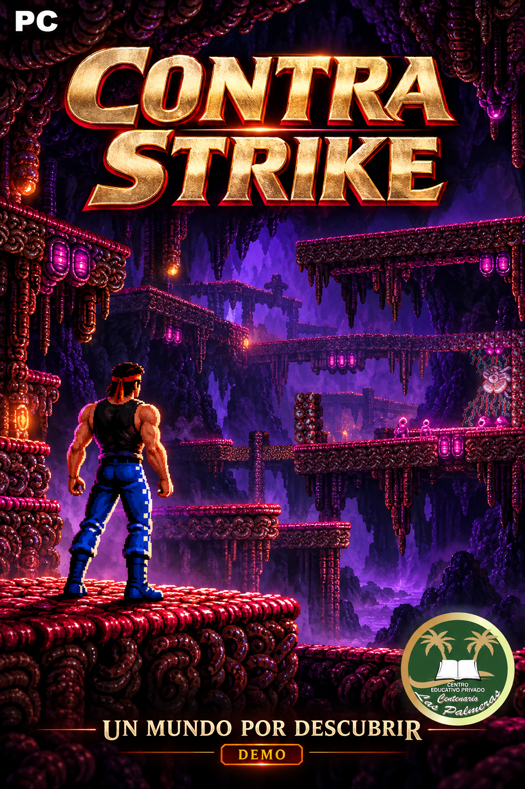
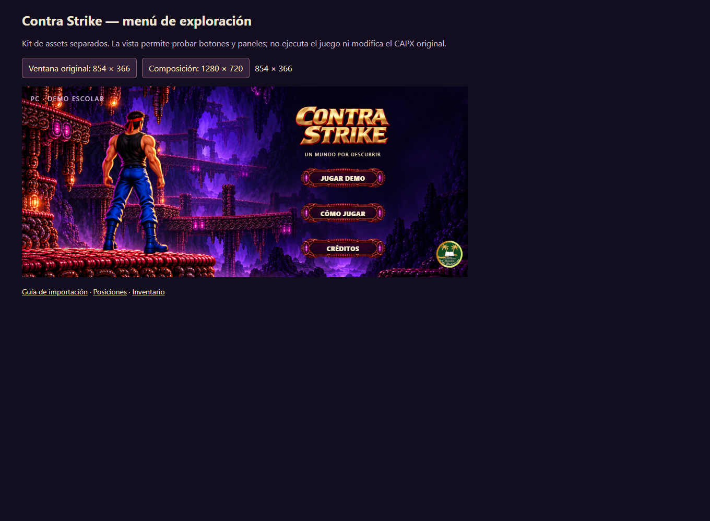
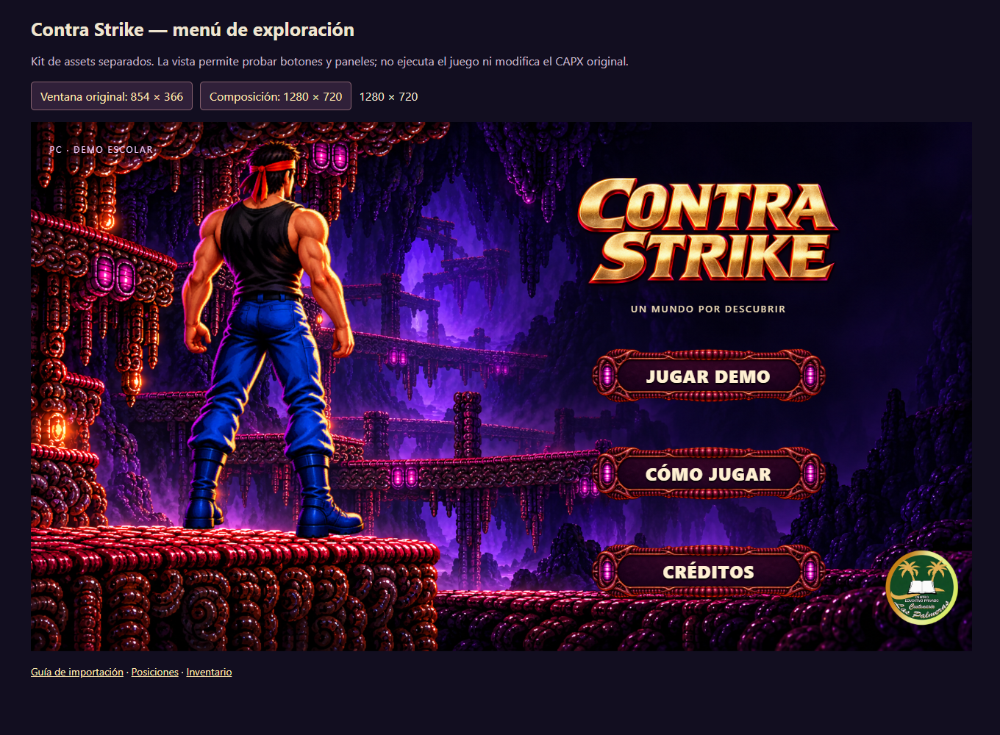
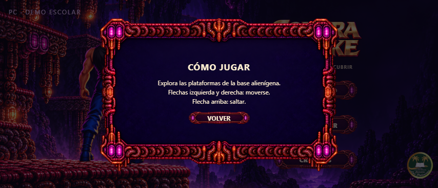
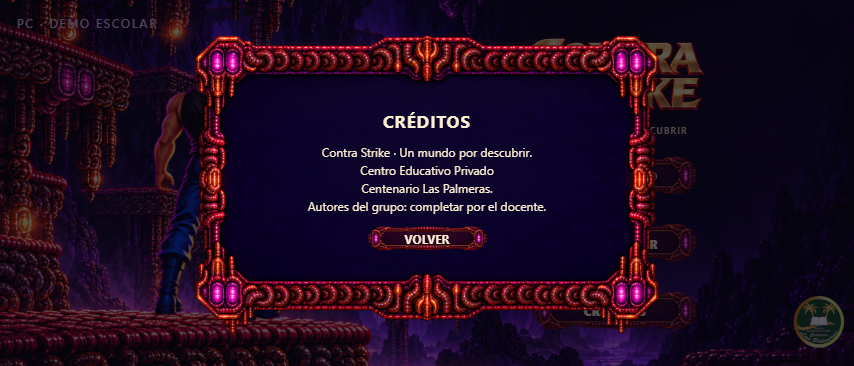

# 🪐 Contra Strike — Un Mundo por Descubrir

<p align="center">
  
</p>

<p align="center">
  <a href="https://github.com/hfreedo/Contra-Strike/releases/latest/download/Contra_Strike_con_menu.capx">
    
  </a>
  <a href="https://github.com/hfreedo/Contra-Strike/releases/latest/download/Contra_Strike_original.capx">
    
  </a>
</p>

---

## 👋 ¡Bienvenidos al repositorio oficial de Contra Strike!

Este repositorio contiene el proyecto de **Contra Strike** desarrollado en **Construct 2**, incluyendo la **versión integrada con menú interactivo (`Contra_Strike_con_menu.capx`)**, el **Kit de Menú v1** con assets separados y coordenadas de posición, vistas de fondo extendido y la **portada imprimible para el stand escolar**.

---

## 📥 1. ¿Cómo descargar el juego y los recursos? (Guía para alumnos)

Tienes **tres formas** de obtener los archivos:

1. **Quiero el juego completo con Menú listo para jugar en Construct 2 (⭐ Muy Recomendado):**
   - Haz clic en el botón verde superior **🎮 Descargar Juego Integrado con Menú (`Contra_Strike_con_menu.capx`)** o entra en [`Proyecto/Contra_Strike_con_menu.capx`](Proyecto/Contra_Strike_con_menu.capx) y pulsa **Download raw file**.
   - ¡Ya tiene el menú conectado, controles de pausa con `ESC`, música ajustada y la animación inicial corregida!
2. **Quiero descargar los archivos individuales o el paquete de la entrega:**
   - Visita la sección [**Releases (Lanzamientos)**](https://github.com/hfreedo/Contra-Strike/releases), donde puedes descargar:
     - `Contra_Strike_con_menu.capx` (Juego integrado listo para jugar)
     - `Contra_Strike_original.capx` (Versión original previa del alumno)
     - `Contra_Strike_Kit_Completo_v1.zip` (Paquete con proyecto y assets de menú)
3. **Quiero descargar todo el repositorio desde GitHub:**
   - Arriba a la derecha en esta página, haz clic en el botón verde **`<> Code`** y selecciona **`Download ZIP`**. Luego descomprime el archivo en tu computadora.

---

## 🎮 2. ¿Cómo funciona la versión integrada `Contra_Strike_con_menu.capx`?

Esta entrega unifica el juego del alumno con la interfaz de usuario:
- **Al abrir el proyecto:** El primer layout es **`Menu`** (`854 × 366`).
- **`JUGAR DEMO`:** Abre directamente el nivel jugable (`Layout 1`).
- **`CÓMO JUGAR` y `CRÉDITOS`:** Muestran paneles informativos con los controles y datos del colegio sin salirse del juego.
- **Regreso al Menú:** Durante la partida, presionar la tecla **`ESC`** o el botón de menú abre un diálogo de confirmación:
  - *SÍ, VOLVER:* Regresa al menú inicial, silencia la música del juego y reanuda la escala temporal.
  - *CANCELAR / ESC:* Vuelve inmediatamente a la acción de la partida.
- **Corrección de animación:** El sprite del personaje ahora inicia correctamente en pose `quieto` en vez de `Default`.

---

## 🖼️ 3. Vista previa del Menú Principal (`Kit_Menu_v1/`)

| Ventana Original del Proyecto (`854 × 366`) | Composición Alternativa HD (`1280 × 720`) |
|:---:|:---:|
|  |  |

| Panel «Cómo Jugar» | Panel «Créditos» |
|:---:|:---:|
|  |  |

💡 *Puedes probar los botones y paneles interactivos abriendo [`Kit_Menu_v1/Vista_previa.html`](Kit_Menu_v1/Vista_previa.html) en cualquier navegador web.*

---

## 🖨️ 4. Materiales Imprimibles para la Exposición (`Imprimibles_Contra_Strike/`)

| Material | Archivo PDF listo para imprimir (A4) | Contenido |
|---|---|---|
| **Portada Promocional 12×18 (v1)** | [`Portada_Contra_Strike_12x18_A4_v1.pdf`](Imprimibles_Contra_Strike/01_Portada_Imprimible/Imprimir/Portada_Contra_Strike_12x18_A4_v1.pdf) · [Digital](Imprimibles_Contra_Strike/01_Portada_Imprimible/Digital/Portada_Contra_Strike_PC_Demo_v1.png) | Portada retail con arte del juego y logo oficial, lista para recortar a 12 × 18 cm para cajas de DVD o soporte de mesa. [Leer instrucciones](Imprimibles_Contra_Strike/01_Portada_Imprimible/LEEME.md) |

---

## 📚 Documentación del equipo en Office

Los tres documentos editables están en [`Documentacion/`](Documentacion/):

| Archivo | Contenido | Descarga directa |
|---|---|---|
| [GDD Contra Strike.docx](Documentacion/GDD%20Contra%20Strike.docx) | Nueve páginas ilustradas con reglas, organización, responsabilidades, bitácora y pruebas pendientes. | [Descargar Word](https://github.com/hfreedo/Contra-Strike/raw/refs/heads/main/Documentacion/GDD%20Contra%20Strike.docx) |
| [Inventario Contra Strike.xlsx](Documentacion/Inventario%20Contra%20Strike.xlsx) | 19 recursos agrupados, 25 miniaturas y una copia M4A de escucha de la música incrustada. | [Descargar Excel](https://github.com/hfreedo/Contra-Strike/raw/refs/heads/main/Documentacion/Inventario%20Contra%20Strike.xlsx) |
| [Guía Contra Strike.pptx](Documentacion/Gu%C3%ADa%20Contra%20Strike.pptx) | Diez diapositivas con controles, consejos y enlaces para recorrer la guía. | [Descargar PowerPoint](https://github.com/hfreedo/Contra-Strike/raw/refs/heads/main/Documentacion/Gu%C3%ADa%20Contra%20Strike.pptx) |

Para escuchar los audios, descargar el inventario, abrirlo en Excel de escritorio para Windows y hacer doble clic en el icono. La reproducción usa el programa asociado a M4A del equipo. Para usar los enlaces de la guía, iniciar el modo presentación en PowerPoint.

El GDD usa un tono de trabajo del grupo e incluye campos para completar integrantes, responsables y créditos. Los documentos muestran el uso de Construct 2 para crear el juego y de Office para organizarlo y explicarlo. También se incluyen al descargar el repositorio con **Code → Download ZIP**.

La documentación toma como referencia la revisión v8 con el mapa limpio. Las capturas identifican las pruebas puntuales anteriores del cuerpo físico y los techos. El recorrido completo sigue pendiente. Esta demo se centra en explorar y saltar; todavía no incorpora disparos, enemigos, puntos ni una victoria programada.

---

## 📂 5. Estructura de carpetas del repositorio

```text
Contra-Strike/
├── Documentacion/                   # GDD Word, inventario Excel y guía PowerPoint
├── Proyecto/
│   ├── Contra_Strike_con_menu.capx     # ⭐ Juego integrado completo listo para abrir en Construct 2
│   ├── Contra_Strike_original.capx     # Versión original base del alumno
│   ├── LEEME_INTEGRACION.md            # Explicación de eventos y navegación
│   └── Vista_fondo/                    # Verificación y vista del escenario extendido
├── Imprimibles_Contra_Strike/          # 🖨️ Materiales listos para imprimir en A4
│   └── 01_Portada_Imprimible/          # Carátula 12x18 cm en A4 y versión digital
├── Kit_Menu_v1/                        # Kit de assets separados de menú
│   ├── Assets/                         # PNGs transparentes (Fondo, Personaje, Botones, Título, Escudo)
│   ├── GUIA_CONSTRUCT_2.md             # Guía manual de importación para Construct 2
│   ├── posiciones_construct.csv        # Tabla de coordenadas exactas para los layouts
│   └── Vista_previa.html               # Simulador interactivo en HTML
└── Portadas/
    └── Contra_Strike_PC_Demo.png       # Ilustración de portada oficial en alta definición
```
